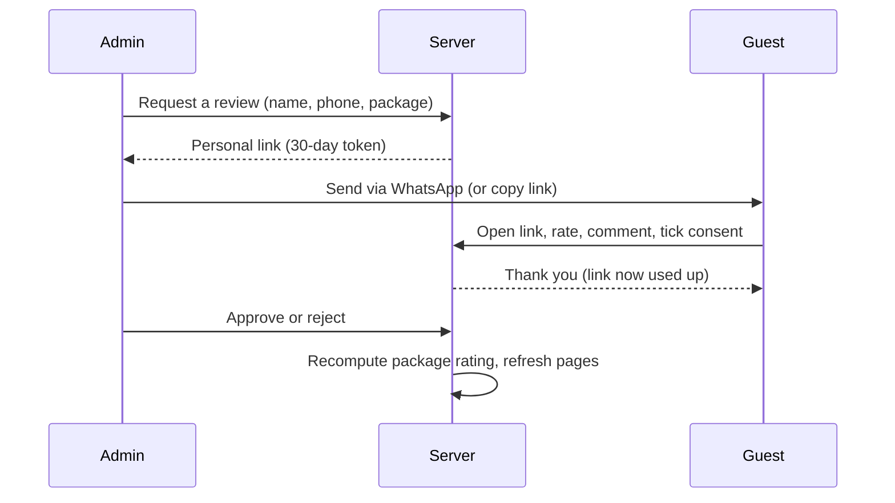

# Pembe Africa Safaris

A marketing website and admin console for a Kenyan safari operator, built with Next.js 14 (App Router).

Pembe sells **one-on-one**. There is no online booking, no booking tracking and no public pricing: every call to action leads to a real conversation over WhatsApp, phone, email or the contact form, so each trip can be quoted and negotiated personally. After a trip, guests leave a review through a personal one-time link that the operator sends.


## Table of contents

- [Features](#features)
- [Tech stack](#tech-stack)
- [Getting started](#getting-started)
- [Environment variables](#environment-variables)
- [Project structure](#project-structure)
- [Routes](#routes)
- [Security model](#security-model)
- [Database](#database)
- [Reviews flow](#reviews-flow)
- [Contact and enquiry flow](#contact-and-enquiry-flow)
- [Deployment](#deployment)
- [Testing checklist](#testing-checklist)
- [Known limitations](#known-limitations)

## Features

**Public site**
- Safari package catalogue with detail pages. Packages show a "Tailored quote" line instead of a price.
- Destinations, gallery, about and why-choose-us pages.
- Floating contact dock (WhatsApp, call, email). On a package page the WhatsApp message is prefilled with that package's name.
- Contact form with package prefill (`/contact?package=<slug>`).
- Approved guest reviews on the home page and on each package page.

**Admin console** (Google sign-in, allow-listed emails only)
- Dashboard with review counts and a shortcut to request a review.
- Package management: search, filter, create, edit, activate or draft, delete, image upload. Bottom-sheet editing on phones, side drawer on desktop.
- Reviews hub: request a review, send the link, resend, moderate, approve or reject.

## Tech stack

| Area | Choice |
| --- | --- |
| Framework | Next.js 14 (App Router), React 18, TypeScript (strict) |
| Styling | Tailwind CSS 3, lucide-react icons, Swiper |
| Auth | NextAuth v4 (Google provider, JWT sessions) |
| Database and storage | Supabase (Postgres + Storage) |
| Email | Resend (contact form) |
| Hosting | Vercel (assumed; no deployment config is committed) |

## Getting started

**Prerequisites:** Node.js 18.17 or newer, npm, a Supabase project, a Google OAuth client, and a Resend account.

```bash
git clone <your-repo-url>
cd <repo-folder>
npm install
cp .env.example .env.local   # then fill in the values
npm run dev                  # http://localhost:3000
```

Other scripts:

```bash
npm run build   # production build
npm run start   # serve the production build
npm run lint    # see Known limitations
```

Before the admin works you also need to apply the database SQL in [Database](#database) and create the storage bucket.

## Environment variables

Copy `.env.example` and fill in every value. Never commit real values.

| Variable | Purpose | Exposure | Required |
| --- | --- | --- | --- |
| `NEXT_PUBLIC_SUPABASE_URL` | Supabase project URL | Public | Yes |
| `NEXT_PUBLIC_SUPABASE_ANON_KEY` | Supabase anon key | Public | Yes |
| `SUPABASE_SERVICE_ROLE_KEY` | Full-access key used only by server code | **Server only** | Yes |
| `NEXTAUTH_URL` | Canonical URL of the site | Server | Yes |
| `NEXTAUTH_SECRET` | Secret for signing sessions (`openssl rand -base64 32`) | Server | Yes |
| `GOOGLE_CLIENT_ID` | Google OAuth client ID | Server | Yes |
| `GOOGLE_CLIENT_SECRET` | Google OAuth client secret | Server | Yes |
| `ADMIN_EMAILS` | Comma-separated emails allowed into the admin | Server | Yes |
| `RESEND_API_KEY` | Resend API key for contact-form email | Server | Yes |
| `CONTACT_EMAIL` | Inbox that receives contact-form messages | Server | Yes |
| `NEXT_PUBLIC_SITE_URL` | Real production URL, used to build review links | Public | Yes |
| `NEXT_PUBLIC_WHATSAPP_NUMBER` | WhatsApp number, digits only with country code | Public | Yes |
| `NEXT_PUBLIC_PHONE` | Phone number for the call button | Public | Yes |
| `NEXT_PUBLIC_CONTACT_EMAIL` | Email shown on the site and in the dock | Public | Yes |

> **Important:** `SUPABASE_SERVICE_ROLE_KEY` must **never** have a `NEXT_PUBLIC_` prefix. Anything with that prefix is shipped to every visitor's browser.

## Project structure

```
app/
  (public)/            Public pages. Layout: Navbar, Footer, ContactDock
  (admin)/admin/       Admin pages. Layout: AuthGuard + slim admin top bar only
  admin-login/         Google sign-in page
  api/
    auth/              NextAuth handler
    admin/             Protected admin routes (packages, reviews, uploads)
    reviews/[token]/   Public review submission (token-gated)
    contact/           Contact form -> Resend
  layout.tsx           Root layout: fonts, metadata, JSON-LD, session provider
  robots.ts            Allows all, disallows /admin and /review/
components/
  sections/            Navbar, Footer, Hero, Destinations, Testimonials ...
  reviews/             ReviewForm
  ui/                  ContactDock
  auth/                AuthGuard
lib/
  auth/                getAdminEmails(), requireAdmin()
  supabase/            client.ts (anon) and admin.ts (service role, server-only)
  reviews/             Review queries and rating recompute helpers
  contact.ts           WhatsApp, call and email link builders
middleware.ts          Security headers
```

The admin area deliberately has no public Navbar, Footer or contact dock.

## Routes

**Public pages**

| Route | Notes |
| --- | --- |
| `/` | Home, featured packages, approved reviews (revalidates every 60 s) |
| `/safaris`, `/safaris/[id]` | Catalogue and detail, with that package's reviews |
| `/destinations/[slug]`, `/gallery`, `/about`, `/whychooseus` | Content pages |
| `/contact` | Contact form, accepts `?package=<slug>` |
| `/review/[token]` | Guest review form. Token-gated, `noindex`, no-referrer |
| `/admin-login` | Admin sign-in |

**Admin pages** (signed-in allow-listed users): `/admin/dashboard`, `/admin/packages`, `/admin/packages/new`, `/admin/reviews`.

**API routes**

| Route | Access |
| --- | --- |
| `/api/auth/[...nextauth]` | NextAuth |
| `/api/contact` | Public (sends email) |
| `/api/reviews/[token]` | Valid, unexpired, unused token |
| `/api/admin/packages`, `/api/admin/packages/[id]` | Admin only |
| `/api/admin/reviews`, `/api/admin/reviews/[id]` | Admin only |
| `/api/admin/uploads` | Admin only |

Removed on purpose: `/track`, `/book-now`, the public bookings flow and public prices.

## Security model

- **Admin sign-in:** Google via NextAuth. Only emails in `ADMIN_EMAILS` (trimmed, lower-cased) can sign in.
- **Every `/api/admin/*` handler starts with `requireAdmin()`**, which checks the signed server-side session. It never trusts headers the caller controls.
- **Service-role client is server-only.** `lib/supabase/admin.ts` imports `server-only`, and no client component may import it. Admin pages call the protected API routes with `fetch()`.
- **Input whitelisting.** Update routes accept only a fixed list of fields and never spread the request body into a database update.
- **Uploads:** JPEG, PNG and WebP only, 5 MB cap, server-generated filenames. The client's filename and path are ignored.
- **Reviews:** the `reviews` table has RLS enabled with no policies, so the anon key gets nothing. All review reads and writes go through server code.
- **Security headers** are set in `middleware.ts`.

## Database

Supabase Postgres. Tables used by the code:

| Table | Key columns |
| --- | --- |
| `packages` | `id`, `title`, `slug`, `location`, `duration`, `group_size`, `description`, `main_image`, `badge`, `featured`, `active`, `rating`, `reviews_count`, `created_at`, `updated_at` |
| `reviews` | `id`, `package_id`, `customer_name`, `customer_phone`, `customer_email` (optional), `trip_date`, `rating`, `content`, `display_name`, `publish_consent`, `status`, `token`, `token_expires_at`, `submitted_at`, `created_at` |

`reviews.booking_id` is a legacy column left over from the old bookings feature. New reviews leave it empty. The `bookings` table is no longer used by the app.

**Storage:** create a public bucket named `safari-images` for package photos.

**Reviews migration.** Run in the Supabase SQL editor (before deploying):

```sql
-- Must return zero rows; otherwise resolve duplicates first
SELECT booking_id, count(*) FROM reviews
WHERE booking_id IS NOT NULL GROUP BY booking_id HAVING count(*) > 1;
```

```sql
ALTER TABLE reviews ALTER COLUMN customer_email DROP NOT NULL;

ALTER TABLE reviews
  ADD COLUMN IF NOT EXISTS package_id uuid REFERENCES packages(id) ON DELETE SET NULL,
  ADD COLUMN IF NOT EXISTS submitted_at timestamptz,
  ADD COLUMN IF NOT EXISTS token_expires_at timestamptz,
  ADD COLUMN IF NOT EXISTS publish_consent boolean NOT NULL DEFAULT false,
  ADD COLUMN IF NOT EXISTS display_name text,
  ADD COLUMN IF NOT EXISTS customer_phone text,
  ADD COLUMN IF NOT EXISTS trip_date date,
  ADD CONSTRAINT reviews_submitted_has_rating
    CHECK (submitted_at IS NULL OR rating IS NOT NULL);

CREATE UNIQUE INDEX IF NOT EXISTS reviews_one_per_booking
  ON reviews(booking_id) WHERE booking_id IS NOT NULL;

-- No policies on purpose: anon gets nothing; the server key bypasses RLS
ALTER TABLE reviews ENABLE ROW LEVEL SECURITY;
```

> RLS policies for `packages` are not committed to this repo. See [Known limitations](#known-limitations).

## Reviews flow



1. In **Admin > Reviews**, tap **Request a review** and enter the guest's name, WhatsApp number and package.
2. Tap **Send via WhatsApp**, which opens a chat with a prefilled message and the link. **Copy link** works without a phone number.
3. The guest opens `/review/<token>`, picks a star rating, writes a comment, sets a display name and ticks the consent box.
4. The submission lands under **To moderate**. The admin can approve it only if the guest gave consent.
5. Approving or rejecting recomputes the package's average rating and review count and refreshes the public pages.

Rules:
- Each token works **once** and expires after **30 days**. **Resend** issues a new token and invalidates the old one.
- Customers can set only rating, comment, display name and consent. Status is controlled by the admin.
- Public pages show only display name, rating, comment and date. Phone, email and token never reach the public.
- A honeypot field and a per-IP rate limit protect the submit endpoint.
- The admin cannot edit a guest's words, only approve or reject.

## Contact and enquiry flow

- `lib/contact.ts` builds WhatsApp (`wa.me`), `tel:` and `mailto:` links from the `NEXT_PUBLIC_*` variables above.
- The **ContactDock** floats on every public page with WhatsApp, Call and Email. On `/safaris/[id]` the WhatsApp message names the package.
- Package cards link to WhatsApp and to `/contact?package=<slug>`, which pre-selects the package in the form.
- `/api/contact` emails the message to `CONTACT_EMAIL` through Resend. The sender domain must be verified in Resend.

## Deployment

Designed for Vercel. No `vercel.json` or CI config is committed.

1. Import the repository into Vercel.
2. Add every variable from [Environment variables](#environment-variables). Make sure `NEXT_PUBLIC_SITE_URL` and `NEXTAUTH_URL` are the real production domain, because review links are built from it.
3. In Google Cloud Console, add `https://<your-domain>/api/auth/callback/google` as an authorised redirect URI.
4. Apply the SQL in [Database](#database) and create the `safari-images` bucket.
5. Verify your sending domain in Resend.
6. Deploy, then run the [testing checklist](#testing-checklist).

If you ever expose the service-role key (for example by committing it or using a `NEXT_PUBLIC_` name), rotate it in Supabase under Settings, then API, and update it on the host.

## Testing checklist

There is no automated test suite yet. Run `npx tsc --noEmit` and `npm run build`, then check manually:

**Security (logged out, private window)**
- [ ] `POST /api/admin/packages` returns `401`. Repeat for the other `/api/admin/*` routes.
- [ ] A Google account not in `ADMIN_EMAILS` cannot sign in.
- [ ] The service-role key does not appear in `.next/static`.
- [ ] Querying `reviews` with only the anon key returns nothing.

**Admin**
- [ ] No Navbar, Footer or contact dock on admin pages or `/admin-login`.
- [ ] Create, edit, toggle and delete a package. Upload an image.
- [ ] Request a review, copy and send the link, resend it (old link stops working).

**Review flow**
- [ ] Open the link, submit once, then confirm a second submission is refused.
- [ ] An expired or made-up token shows "This link isn't valid".
- [ ] Approving without consent is blocked. An approved review shows on the home and package pages, with no email or token in the page source.

**Public site**
- [ ] No prices or booking buttons anywhere (check page source and JSON-LD too).
- [ ] `/track/x` and `/book-now` return 404.
- [ ] The WhatsApp message on a package page names the package. Call, email and `/contact?package=` prefill all work.

## Known limitations

- **Rate limiting is in-memory,** so it is per serverless instance. It stops casual spam only. Move it to Upstash Redis or a table if needed.
- **RLS policies for `packages` are not committed.** Add migration files under `supabase/migrations/` so the database setup is reproducible.
- **Canonical domain is not fully settled.** A few old domain strings may remain in the image config and email sender. Search the repo and unify them.
- **Linting:** ESLint and `eslint-config-next` may not be installed, so `npm run lint` can fail until they are added.
- **Unused code:** some unused dependencies and empty stub files may remain and can be removed.
- **No automated tests** yet.

## License

Proprietary. All rights reserved. Replace this section if you choose a different license.
